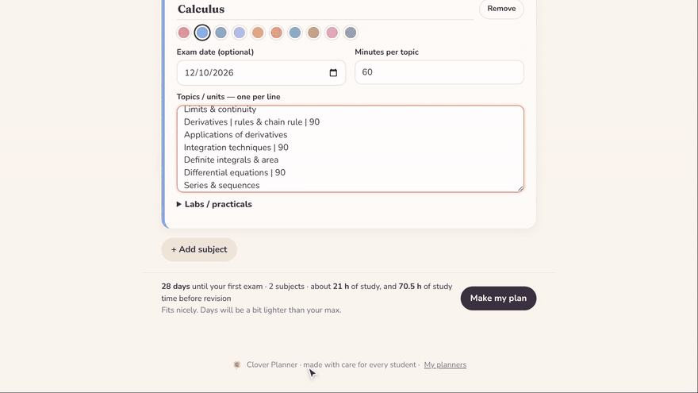
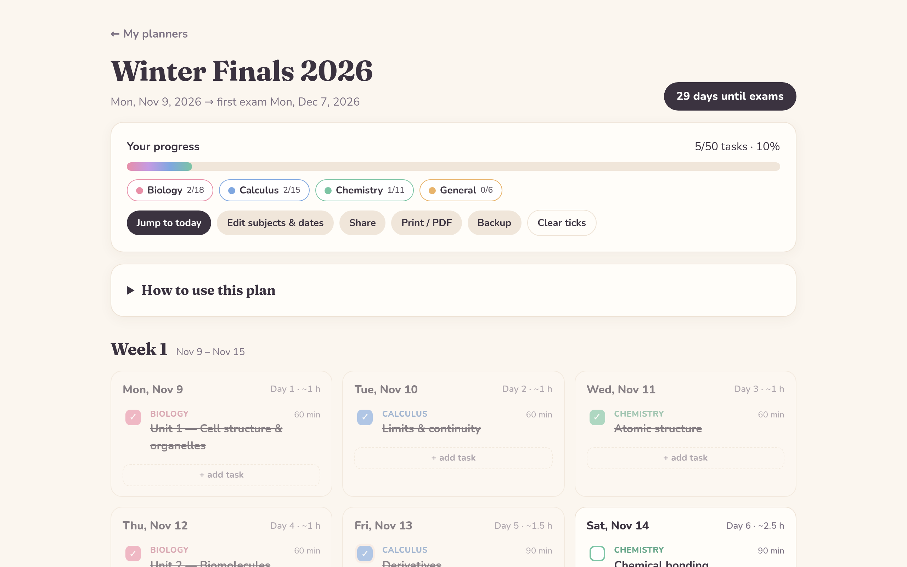
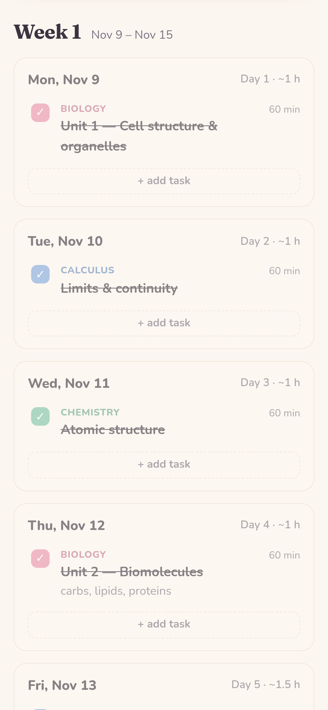
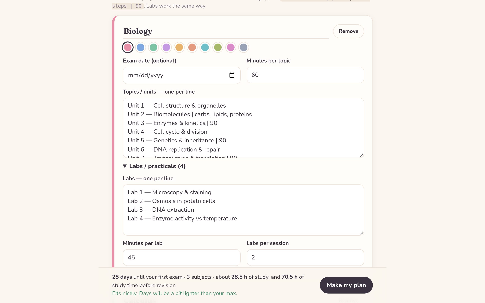

<p align="center">
  
</p>

<h1 align="center">
  &nbsp;Clover Planner
</h1>

<p align="center">
  <em>Turn your syllabus into a study plan that actually feels doable.</em>
</p>

<p align="center">
  
  
  
  
</p>

<p align="center">
  <a href="https://vercel.com/new/clone?repository-url=https%3A%2F%2Fgithub.com%2FLyra-4leafclover%2Fclover-planner&project-name=clover-planner&repository-name=clover-planner"></a>
</p>

<p align="center">
  
</p>

---

## 🍀 &nbsp;What it does

Paste your topics and exam dates. Clover builds a realistic day-by-day plan, then lets you change anything you like.

<table>
  <tr>
    <td width="33%" valign="top"><b>📚 &nbsp;Any subjects, any exams</b><br>Topics and labs one per line, with their own exam date for each subject.</td>
    <td width="33%" valign="top"><b>🗓️ &nbsp;A plan in one click</b><br>Subjects mixed every day, practice after theory, weekly catch-up days and final revision.</td>
    <td width="33%" valign="top"><b>⏳ &nbsp;Fits your real hours</b><br>Set weekday and weekend hours. Clover warns you if it won't fit.</td>
  </tr>
  <tr>
    <td valign="top"><b>✏️ &nbsp;Fully editable</b><br>Edit, add or delete tasks, and drag them to another day.</td>
    <td valign="top"><b>✅ &nbsp;Progress you can see</b><br>Tick things off, track each subject, and filter to one subject at a time.</td>
    <td valign="top"><b>💌 &nbsp;Share &amp; back up</b><br>Send a friend their own copy as a link, print it as a PDF, or save a backup file.</td>
  </tr>
</table>

## 🌸 &nbsp;A peek inside

<table>
  <tr>
    <td width="68%"></td>
    <td width="32%" rowspan="2"></td>
  </tr>
  <tr>
    <td></td>
  </tr>
</table>

## ✍️ &nbsp;How to use it

1. Click **+ New planner**, then give it a name and pick your start and exam dates.
2. Set how many hours you can really study on weekdays, weekends and your catch-up day.
3. Add your subjects. Paste the topics and labs, one per line.
4. Click **Make my plan**. You can still change any day afterwards.

You can add details and a time to any line with `|`:

```text
Unit 3 — Enzymes & kinetics | Michaelis–Menten, inhibitors | 90
```

That line becomes a 90-minute task called *Unit 3 — Enzymes & kinetics*, with the details underneath.

## 🔒 &nbsp;Your data

There are no accounts and no server. Everything you make is saved in your own browser, so each visitor only ever sees their own planners. To move planners to another device, use **Backup** and then **Open a backup file** there.

## 🚀 &nbsp;Make your own copy

**On Vercel (free):** click the **Deploy with Vercel** button above, sign in with GitHub and click **Deploy**. After that, the site updates itself every time this repo changes.

**On any other static host** (Netlify, GitHub Pages, Cloudflare Pages…): upload the files as they are. There's nothing to build.

**On your computer:** open a terminal in this folder, run `python3 -m http.server 8080`, then open http://localhost:8080. Just double-clicking `index.html` won't work, because browsers block the scripts on `file://` pages.

## 🎨 &nbsp;Make it yours

| File | What to change there |
| --- | --- |
| `css/style.css` | Colours and fonts. The `:root` colours at the top restyle the whole site. |
| `js/example.js` | The example planner new visitors see first. |
| `js/generate.js` | How plans are built: subject balancing, catch-up days, revision and days between exams. |
| `js/app.js` | The pages: home, setup, planner and shared links. |
| `assets/` | Watercolor artwork and icons. |

<br>

<p align="center">
  <br>
  <sub>made with care for every student · by <a href="https://github.com/Lyra-4leafclover">@Lyra-4leafclover</a></sub>
</p>
